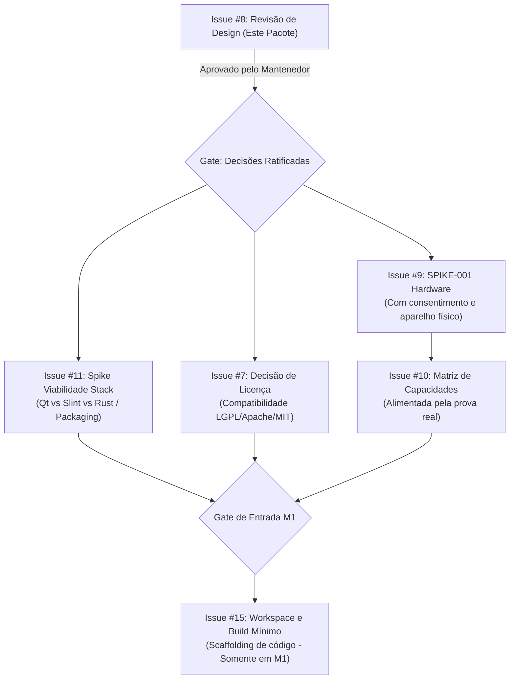

# Pacote de Revisão e Decisões de Design (M0) — Issue #8

**Status:** PROPOSTO / EM REVISÃO HUMANA (não autoriza implementação de código)  
**Data:** 2026-10-18  
**Autor:** Agente Executor (Issue #8)  
**Contexto:** Milestone M0 — Foundation & Feasibility | Épico #1  
**Documentos Base Analisados:**
- [AGENTS.md](../../AGENTS.md)
- [README.md](../../README.md)
- [docs/product/PRD.md](../product/PRD.md)
- [docs/architecture/system.md](../architecture/system.md)
- [docs/architecture/decisions/ADR-0001-scrcpy-external.md](../architecture/decisions/ADR-0001-scrcpy-external.md)
- [docs/architecture/decisions/ADR-0002-capability-first.md](../architecture/decisions/ADR-0002-capability-first.md)
- [docs/architecture/decisions/ADR-0003-no-root.md](../architecture/decisions/ADR-0003-no-root.md)
- [docs/superpowers/specs/2026-10-18-limivra-design.md](../superpowers/specs/2026-10-18-limivra-design.md)
- [docs/research/SPIKE-001.md](../research/SPIKE-001.md)
- [docs/research/rea-plan.md](../research/rea-plan.md)
- [docs/governance/security-and-legal.md](../governance/security-and-legal.md)
- [docs/testing/strategy.md](../testing/strategy.md)
- [docs/planning/roadmap.md](roadmap.md)
- [docs/planning/backlog.md](backlog.md)
- [docs/planning/issue-manifest.json](issue-manifest.json)
- [CONTRIBUTING.md](../../CONTRIBUTING.md)
- [SECURITY.md](../../SECURITY.md)

---

## 1. Resumo Executivo

O objetivo do projeto **Limivra** é permitir o uso e controle de aplicativos Android em computadores Linux via conexão USB ou Wi-Fi, mantendo a premissa fundamental:
> **O Android executa os aplicativos; o Linux exibe e encaminha os controles.** Nenhum APK é executado no host Linux.

Este pacote de revisão de design cumpre o mandato da **Issue #8** no **Milestone M0**. Ele avalia rigorosamente a viabilidade conceitual da arquitetura proposta, consolida a rastreabilidade entre requisitos e decisões, disseca trade-offs arquiteturais fundamentais, mapeia lacunas e inconsistências documentais, e estrutura **decisões humanas pendentes** com opções concretas, impactos e recomendações técnicas não vinculantes.

### Principais Conclusões:
1. **Separação Obrigatória dos Três Modos:** O sistema deve manter distinção estrita e inegociável entre `MIRROR` (espelhamento físico), `VIRTUAL_DISPLAY` (display secundário independente sem suporte a launcher garantido) e `DESKTOP_WINDOWING` (múltiplas janelas livres / freeform). O suporte a um modo jamais pode ser presumido como suporte aos demais.
2. **Postura de Capabilities (`UNKNOWN` por padrão):** O suporte de ROMs Android (especialmente forks customizados como Xiaomi HyperOS) a telas secundárias e janelas flutuantes varia drasticamente. Recursos devem ser tratados como `UNKNOWN` até verificação em tempo de execução via sondagem observável.
3. **Restrição Arquitetural Sem-Root:** A baseline do Limivra opera estritamente sem root, sem desbloqueio de bootloader, sem bypass de DRM/FLAG_SECURE e sem alteração persistente da ROM. Quando um recurso avançado falhar, a aplicação deve executar fallback transparente, consentido e explicativo para `MIRROR`.
4. **Isolamento de Subprocessos e Teardown:** A orquestração via subprocessos (`adb`, `scrcpy`) deve ser restrita exclusivamente aos PIDs gerados pela sessão Limivra. Comandos globais destrutivos como `killall adb` ou `killall scrcpy` são estritamente proibidos.
5. **Estado Normativo:** Nenhum documento tem seu status alterado para `ACCEPTED` ou `APPROVED` por este documento. Todas as propostas permanecem `PROPOSED` até manifestação explícita do mantenedor.

---

## 2. Baseline Verificada e Fontes

### 2.1 Ambiente de Execução Auditado
- **Host:** `pedro-550XED` (Linux x86_64, kernel 6.8.0-58-generic)
- **Repositório:** `/home/pedro/Projetos/miscellaneous/limivra`
- **Remote:** `https://github.com/pedro-labsabs/limivra.git`
- **Branch de Trabalho (Isolada):** `agent/8-m0-design-review` em worktree `/home/pedro/Projetos/miscellaneous/limivra-worktrees/issue-8-m0-design-review`
- **HEAD e Merge-Base:** `9d091d24efc43059fc978e393860843b75bdf89b` (sincronizado com `origin/main`)
- **Status do Workspace:** Limpo (`working tree clean`, `git diff --check` exit 0).
- **Toolchain do Host:**
  - `rustc`: 1.88.0 (disponível em `~/.cargo/bin/rustc`)
  - `cargo`: 1.88.0 (disponível em `~/.cargo/bin/cargo`)
  - `pkg-config`: 1.8.1 (disponível em `/usr/bin/pkg-config`)
  - `adb`, `scrcpy`, `cmake`, `qmake`, `qmake6`, `ninja`, `clang`: **Ausentes do PATH**.
  - `Qt6Core`, `Qt6Quick`, `Qt6Widgets`: **Não detectados via pkg-config**.
- **Código de Produto e Workspace de Compilação:** Inexistentes (`Cargo.toml` ausente, `CMakeLists.txt` ausente).

### 2.2 Hierarquia Normativa de Fontes
Em conformidade com [AGENTS.md](../../AGENTS.md):
1. **Segurança e Conformidade Legal** (`SECURITY.md`, `docs/governance/security-and-legal.md`, limites de REA)
2. **Decisão Humana / ADR Aceita** (Atualmente nenhuma aceita; todas em status `PROPOSED`)
3. **Comportamento Provado no HEAD** (Atualmente apenas documentação validada)
4. **Contratos e Especificações Aprovadas** (Em fase de revisão)
5. **Documentos Propostos** (`docs/superpowers/specs/2026-10-18-limivra-design.md`, `docs/product/PRD.md`, `docs/architecture/system.md`, ADRs 0001 a 0003)
6. **Backlog e Roadmap** (`docs/planning/roadmap.md`, `docs/planning/backlog.md`, `docs/planning/issue-manifest.json`)
7. **Hipóteses Técnicas** (Hipótese de stack Qt/Rust, hipóteses do SPIKE-001).

---

## 3. Matriz de Rastreabilidade (PRD → Spec → ADR → Issue)

A tabela abaixo cruza cada requisito do PRD com os componentes da especificação de arquitetura, as ADRs correspondentes, as issues vinculadas no manifesto e seu status de validação.

| ID Requisito | Descrição Sintética | Componente na Spec / Arquitetura | ADR Relacionada | Issues Vinculadas | Estado Atual | Evidência / Pré-requisito de Aceite |
|---|---|---|---|---|---|---|
| **FR-01** | Enumerar aparelhos (0/1/N, offline, unauthorized, seleção explícita) | `DeviceProvider` (ADB device discovery e auth) | ADR-0002 | #16 (Task), #19 (UI Picker) | **PROPOSTO** | Testes unitários com mocks de `adb devices -l`; UI sem auto-seleção cega em caso de múltiplos seriais. |
| **FR-02** | Sessão USB mirror sem root e desligamento limpo | `ScrcpyAdapter`, `MirrorProvider`, `Session` | ADR-0001, ADR-0003 | #9 (Spike), #18 (Scrcpy), #20 (E2E) | **PROPOSTO** | Teste em hardware no SPIKE-001; encerramento de processo limpo sem órfãos. |
| **FR-03** | Detector de capacidades (`SUPPORTED`, `UNSUPPORTED`, `UNKNOWN`, `BLOCKED`) | `CapabilityProbe` com `Capabilities` struct | ADR-0002 | #10 (Task), #21 (Flag Gate) | **PROPOSTO** | Modelo de dados com `reason`, `evidence`, `version`, `timestamp`. Padrão `UNKNOWN`. |
| **FR-04** | Display virtual com app em tela secundária e tela física livre | `DisplayProvider`, `VirtualDisplayProvider` | ADR-0002, ADR-0003 | #9 (Spike), #22 (VD Provider) | **PROPOSTO / HIPÓTESE** | Suporte depende de validação física do SPIKE-001 no HyperOS/Redmi. |
| **FR-05** | Fallback transparente e consentido de virtual para mirror | `SessionCore`, `DisplayProvider` | ADR-0002 | #23 (VD Fallback) | **PROPOSTO** | Mensagem de erro explicativa ao usuário com diálogo de confirmação; sem fallback silencioso. |
| **FR-06** | Entrada e foco (mouse, teclado, atalhos, clipboard) | `ScrcpyAdapter`, UI Event forwarding | ADR-0001 | #26 (Input) | **PROPOSTO** | Mapeamento de cliques, teclas modificadoras e tratamento de restrição de input Xiaomi/HyperOS. |
| **FR-07** | Recuperação de falhas, timeouts, reconexão e teardown idempotente | `Session` state machine, `Diagnostics` | ADR-0001 | #17 (State), #20 (E2E) | **PROPOSTO** | Matriz de erros com transições estritas para `STOPPING` / `IDLE`; sem `killall`. |
| **FR-08** | Diagnósticos privados com logs sanitizados (sem seriais, tokens, PII) | `Diagnostics`, sanitizador de strings | ADR-0002 | #31 (Threat), #6 (QA Epic) | **PROPOSTO** | Verificação de logs gerados: substituição de seriais por hashes curtos/aliases; logs opt-in. |
| **FR-09** | Conexão Wi-Fi pareada, autorizada e restrita à rede local | `DeviceProvider` (transporte TCP/IP), `Session` | ADR-0003 | #27 (WiFi) | **PROPOSTO** | Exige pareamento ADB explícito (Android 11+ pairing ou manual); sem portas públicas expostas. |
| **FR-10** | Freeform / Desktop windowing condicionado a teste observável | `DesktopWindowingProvider` | ADR-0002 | #9 (Spike), #28 (Freeform) | **PROPOSTO / HIPÓTESE** | Padrão `UNSUPPORTED` ou `UNKNOWN`; só expor como `SUPPORTED` após prova visual de múltiplas janelas livres. |

---

## 4. Análise Crítica: Inconsistências, Lacunas e Requisitos Ambíguos

Durante a auditoria cruzada dos documentos vigentes, foram identificadas as seguintes ambiguidades que necessitam de resolução formal:

### 4.1 Granularidade da Máquina de Estados da Sessão
- **Fato Observado:** Em `docs/architecture/system.md`, o ciclo de vida da sessão é definido como:  
  `IDLE → DISCOVERING → WAITING_FOR_AUTH → READY → STARTING → ACTIVE → STOPPING → IDLE` (com nó de `ERROR`).
- **Ambiguidade:** Onde se posiciona o estado de sondagem de capacidades (`PROBING`)? Uma sessão deve sondar antes ou depois de `READY`?
- **Proposta de Resolução:** A sondagem de capacidades pertence à transição entre `WAITING_FOR_AUTH` e `READY`. O dispositivo só é considerado `READY` quando suas capacidades básicas de transporte e autorização foram catalogadas, gerando um `DeviceRef` enriquecido com `Capabilities`.

### 4.2 Restrição de Entrada no HyperOS / MIUI ("Depuração USB (Configurações de Segurança)")
- **Fato Observado:** Em aparelhos Xiaomi/Redmi com HyperOS/MIUI, a depuração USB comum permite vídeo e comandos ADB shell, mas rejeita injeção de toques/cliques e teclas via `scrcpy` a menos que uma opção adicional ("Depuração USB (Configurações de Segurança)") seja habilitada com cartão SIM e conta Mi.
- **Ambiguidade:** O PRD (FR-02 e FR-06) e a ADR-0003 demandam funcionamento sem root e sem hacks. Se o usuário conectar um aparelho que bloqueia injeção de input, como o sistema deve reagir?
- **Proposta de Resolução:** Definir o estado de capacidade de entrada como `INPUT_RESTRICTED` (subestado de `BLOCKED` para injeção de eventos). A UI deve exibir claramente o stream de vídeo, mas apresentar aviso informativo sobre a restrição de segurança específica do fabricante, sem tentar burlar controles nem alterar configurações do sistema operacional de forma invasiva.

### 4.3 Gestão de Telas Virtuais e Janelas no Modo Desktop
- **Fato Observado:** O PRD menciona `VIRTUAL_DISPLAY` e `DESKTOP_WINDOWING`. A documentação do scrcpy indica que `--new-display` cria uma tela virtual no VirtualDisplay manager do Android. Contudo, em muitas ROMs, o Android não inicia automaticamente um launcher secundário nessa tela, exibindo tela preta caso nenhum app seja explicitamente lançado nela com `--start-app` ou `am start --display <id>`.
- **Ambiguidade:** O usuário pode interpretar a tela preta como falha de conexão do Limivra.
- **Proposta de Resolução:** O Limivra nunca deve criar um display virtual vazio sem um aplicativo-alvo definido (ex.: `--start-app=<package>`) ou sem um pseudo-launcher inicial. Caso o app falhe em inicializar no display secundário, o sistema deve detectar o encerramento do processo e acionar o fallback para `MIRROR`.

---

## 5. Comparação Arquitetural e Análise de Trade-Offs

### 5.1 Interface e Núcleo: Qt 6/QML + Rust vs. Alternativas
A combinação Qt 6/QML + Rust foi proposta como stack de referência, mas permanece **não aprovada**.

| Alternativa | Vantagens | Desvantagens e Riscos | Dependências e Complexidade | Recomendação Técnica |
|---|---|---|---|---|
| **A. Qt 6 (QML/C++) + Rust (cxx / qmetaobject)** *(Proposta Atual)* | Interface moderna, acelerada por hardware, excelente suporte a Wayland e X11; Rust traz confiabilidade no gerenciamento de subprocessos, parsing rigoroso e controle de memória sem vazamentos. | Complexidade alta de FFI (linking C++/Rust); toolchain pesado; ausência de Qt 6 no ambiente atual do host (necessita empacotamento complexo no Linux). | Qt6Core, Qt6Quick, C++17, Cargo, cxx/qmetaobject. | **Manter como Proposta de Estudo (#11)**, mas investigar viabilidade estrita antes de codificar. |
| **B. Rust Puro com GUI Nativa (Slint ou Iced)** | Build unificado puramente via Cargo; empacotamento simplificado sem FFI C++; footprint de memória muito baixo; controle direto de concorrência assíncrona (Tokio). | Ecossistema de widgets desktop e maturidade de integração Wayland/X11 menor que Qt; suporte a docking/múltiplas janelas menos testado. | Rustc, Cargo, bibliotecas do sistema (Wayland/X11 headers). | **Forte Candidata Alternativa** caso o spike #11 aponte custos excessivos de FFI com Qt6. |
| **C. C++ Nativo Puro (Qt 6 ou GTK4)** | Sem barreira de FFI; integração direta com bibliotecas do sistema Linux. | Maior risco de memória e concorrência no gerenciamento assíncrono de subprocessos e pipes de dados; desenvolvimento mais lento de parsers seguros. | Qt6 / GTK4, CMake/Ninja, compilador C++20. | **Desaconselhada:** O custo de segurança e confiabilidade supera o benefício de evitar FFI. |

*Recomendação Não Vinculante:* Manter a hipótese Qt6/QML + Rust como objeto de estudo exclusivo da **Issue #11**, autorizando a avaliação comparativa prática com Slint/Iced em #11 antes da fixação do workspace em #15.

### 5.2 Backend de Vídeo e Entrada: `scrcpy` Subprocesso vs. Embedding Nativo / Protocolo Próprio
A **ADR-0001** propõe o uso do `scrcpy` como binário externo via subprocesso.

| Abordagem | Vantagens | Desvantagens | Riscos | Recomendação |
|---|---|---|---|---|
| **Subprocesso scrcpy** *(ADR-0001 Proposta)* | Reutiliza solução de captura, encoding H.264/H.265 e injeção de entrada madura e otimizada; isola falhas e crashes de vídeo fora do processo principal do Limivra; reversível e fácil de testar. | Janela de vídeo desacoplada (o scrcpy abre sua própria janela SDL); embedding visual requer reparenting X11/Wayland ou hacks gráficos. | Dependência de versão externa do scrcpy instalada no host (mínimo scrcpy v2.2+ para suporte confiável a `--new-display`). | **Aprovar como ADR-0001 Base.** É o único caminho realista para o MVP sem investimento massivo de engenharia em codecs. |
| **scrcpy-server nativo (libscrcpy/FFI ou Stream TCP)** | Permite desenhar o vídeo diretamente dentro do widget da UI Limivra; experiência visual integrada. | Alto custo de manutenção; sincronização de versões com o `scrcpy-server.jar`; implementação própria de decodificação via FFmpeg/VA-API. | Quebra frequente de protocolo a cada atualização do Android. Risco P1 de atrasar o projeto em meses. | **Rejeitar para M0/M1.** Reavaliar apenas em M3 caso o reparenting de janela se mostre inviável. |
| **Protocolo Próprio / VNC / RDP** | Controle total do pipeline. | Performance inaceitável para interações de 60 FPS; requer instalação de app servidor pesado ou root no celular. | Inviável sem violar requisitos de sem-root e performance do PRD. | **Rejeitar Definitivamente.** |

### 5.3 Backend de Controle e Descoberta: Processo ADB
- **Abordagem Proposta:** O Limivra invoca comandos `adb` (`adb devices -l`, `adb track-devices`, `adb -s <serial> shell ...`) como subprocessos assíncronos supervisionados por um `DeviceProvider`.
- **Alternativa Considerada:** Implementar um cliente do protocolo ADB diretamente em Rust (comunicação direta via socket TCP com o servidor ADB local na porta 5037).
- **Avaliação:** Comunicar-se via socket com o daemon ADB (`127.0.0.1:5037`) evita o overhead de spawnar múltiplos processos `adb` por minuto para polling de status, mas o uso da CLI `adb` no MVP simplifica os testes e diagnósticos iniciais.
- **Recomendação:** No MVP (M1), utilizar subprocessos `adb` com limites de timeout rigorosos. Projetar a interface do `DeviceProvider` de forma abstrata para permitir futura migração para cliente de socket ADB sem quebra de contrato.

---

## 6. Contratos Conceituais Que Precisam de Decisão Humana

Para permitir a transição segura para os próximos marcos, os seguintes contratos devem ser explicitamente ratificados ou ajustados pelo mantenedor:

### Contrato 1: Representação de Dispositivo e Higienização de Logs
```rust
pub struct DeviceRef {
    pub serial_hash: String,      // Hash não reversível (ex: SHA256 truncado) para exibição e logs
    pub raw_serial: SecretString, // Protegido em memória, utilizado apenas na passagem de argumentos ADB (-s)
    pub transport: TransportType, // USB | Wifi { ip, port }
    pub state: DeviceState,       // Authorized | Unauthorized | Offline
    pub model: String,            // Nome comercial amigável (ex: "Redmi Note 13")
}
```
*Decisão Necessária:* Homologar que o número de série bruto (`raw_serial`) jamais deve ser serializado em JSON, escrito em stdout/stderr ou salvo em logs de telemetria/diagnóstico.

### Contrato 2: Modelo de Capacidades Observadas (`Capabilities`)
```rust
pub enum CapabilityStatus {
    Supported,
    Unsupported,
    Unknown,
    Blocked { reason: String },
}

pub struct CapabilityReport {
    pub mirror: CapabilityStatus,
    pub virtual_display: CapabilityStatus,
    pub desktop_windowing: CapabilityStatus,
    pub touch_input: CapabilityStatus,
    pub keyboard_input: CapabilityStatus,
    pub audio_forwarding: CapabilityStatus,
    pub evidence: Vec<String>,
    pub probed_at: Timestamp,
}
```
*Decisão Necessária:* Homologar a regra de que todo campo de capacidade nasce como `CapabilityStatus::Unknown` e só transiciona mediante comando observável bem-sucedido.

### Contrato 3: Ciclo de Vida do Subprocesso e Teardown
```text
State Transitions:
[IDLE] 
  → spawn(scrcpy) 
  → [RUNNING { pid, child_handle }]
  → (user stop | child exit | adb disconnect) 
  → [TERMINATING { sigterm sent, timeout_timer }]
  → (graceful exit within 3000ms ? done : send_sigkill)
  → [CLEANED]
  → [IDLE]
```
*Decisão Necessária:* Homologar a proibição terminante de qualquer chamada a `killall` ou comandos de encerramento baseados em nome de processo. A supervisão deve guardar e encerrar exclusivamente os PIDs criados pelo Limivra.

---

## 7. Ameaças, Privacidade e Modelo de Segurança

Conforme estabelecido em `docs/governance/security-and-legal.md` e `SECURITY.md`, o modelo de ameaças do Limivra estabelece:

1. **Vetor de Abuso de Permissão ADB:** A autorização ADB confere controle profundo sobre o Android (acesso a arquivos, gravação de tela, instalação de pacotes). O Limivra **nunca deve:**
   - Habilitar depuração sem fio automaticamente sem confirmação do usuário.
   - Executar comandos privilegiados ou scripts que alterem configurações globais (`settings put global ...`) sem consentimento explícito.
   - Expor portas TCP locais de forward ADB para interfaces de rede públicas (`0.0.0.0`).
2. **Proteção Contra Vazamento de Dados Pessoais (PII):**
   - Logs de execução devem filtrar expressões regulares que correspondam a números de série de hardware, endereços MAC, nomes de redes Wi-Fi privadas e títulos de janelas/notificações.
   - O mecanismo de diagnóstico deve ser estritamente *opt-in*.
3. **Respeito aos Mecanismos de Proteção do SO:**
   - O Limivra não tentará burlar `FLAG_SECURE` (telas protegidas de bancos e gerenciadores de senhas). Se o Android retornar tela preta por restrição de segurança, o Limivra tratará como comportamento normal esperado do sistema operacional.

---

## 8. Questões de Licenciamento e Encaminhamento para a Issue #7

A auditoria confirmou que o repositório **não possui arquivo LICENSE** e nenhuma licença foi formalizada até o momento.
- **Risco Identificado:** A ausência de licença impede a aceitação de contribuições externas e a distribuição de binários.
- **Interação de Licenças com Dependências:**
  - `scrcpy`: Licenciado sob **Apache-2.0**.
  - `Qt 6`: Disponível sob **LGPLv3** ou Comercial. O uso da LGPLv3 impõe restrições estritas de dynamic linking (shared libraries) e obrigações de permitir a substituição da biblioteca pelo usuário final.
  - `Rust Ecosystem`: A maioria das crates utiliza **MIT / Apache-2.0 dual license**.
  - `ADB (Android SDK Platform-Tools)`: Distribuído sob a licença de software da Google/Android SDK (redistribuição de binários sujeita a restrições).
- **Encaminhamento:** Este pacote **não define a licença do projeto**, respeitando a alocação de escopo da **Issue #7**. Fica registrado para a issue #7 que a escolha de licença do Limivra (ex.: GPLv3, AGPLv3, Apache-2.0, ou MIT) terá impacto direto na arquitetura de integração do Qt 6 (LGPLv3) e no modelo de distribuição de pacotes Linux.

---

## 9. Distinção Crucial: Hipótese vs. Prova Documental vs. Prova em Hardware

Para impedir afirmações prematuras no desenvolvimento, todo fato no Limivra deve ser classificado em um de três níveis:

| Nível | Definição | Exemplos no Estado Atual do Projeto |
|---|---|---|
| **Nível 1: Hipótese Arquitetural** | Suposição técnica razoável documentada, pendente de experimentação prática. | • A combinação Qt6/QML + Rust é a melhor stack para o projeto.<br>• O Redmi Note 13 4G suportará display virtual sem fechamento abrupto.<br>• Subprocesso scrcpy com reparenting de janela oferecerá boa UX. |
| **Nível 2: Prova Documental** | Fato verificado em documentações oficiais, especificações de APIs públicas ou código-fonte de projetos abertos de referência. | • O scrcpy suporta a flag `--new-display` a partir da versão 2.2 (conforme docs oficiais do scrcpy).<br>• O Android AOSP introduziu APIs de múltiplos displays no Android 10 (conforme docs AOSP).<br>• A chamada `killall` indiscriminada causa término de processos alheios. |
| **Nível 3: Prova em Hardware** | Fato observado, registrado com comandos sanitizados, logs reais e exit codes em um dispositivo físico específico. | • **Atualmente INEXISTENTE no projeto.**<br>O SPIKE-001 permanece `UNTESTED` até que seja executado fisicamente no aparelho de referência. |

> [!WARNING]
> Nenhuma funcionalidade pode transicionar para o estado de desenvolvimento de produto (M1 em diante) baseando-se unicamente em Hipóteses (Nível 1). A validação de Hardware (Nível 3) é requisito obrigatório de gate.

---

## 10. Proposta de Sequência Pós-Aprovação

Caso o mantenedor humano aprove este pacote de revisão de design, o fluxo de trabalho subsequente no **Milestone M0** deve obedecer rigorosamente à seguinte cadeia de dependências:



### Detalhamento da Sequência:
1. **Ativação da Issue #11 (Spike de Stack):** Analisar dependências do host, viabilidade do Qt6 vs. alternativas Rust nativas (Slint), mecanismos de binding FFI e tamanho de distribuição.
2. **Ativação da Issue #7 (Licença):** Seleção formal da licença pelo mantenedor com base nas obrigações de dependências mapeadas.
3. **Execução da Issue #9 (SPIKE-001):** Realizar o ensaio prático no Redmi Note 13 4G com consentimento humano e registro sanitizado de saídas.
4. **Alimentação da Issue #10 (Matriz de Capacidades):** Estruturar o banco de evidências com os resultados reais do SPIKE-001.
5. **Abertura da Issue #15 (Workspace e Build Mínimo):** Somente após a resolução das issues #7, #8 e #11. A issue #15 estruturará os repositórios/crates de código real.

---

## 11. Decisões Humanas Pendentes para o Mantenedor

O mantenedor é convidado a avaliar e registrar sua decisão sobre os seguintes tópicos centrais:

### Decisão 1: Arquitetura Inicial do Backend de Vídeo (ADR-0001)
- **Opção A (Recomendada):** Aprovar formalmente a **ADR-0001** (uso de `scrcpy` como subprocesso externo na primeira fase, aceitando janela desacoplada inicial).
- **Opção B:** Rejeitar a ADR-0001 e exigir streaming embutido nativo desde o início (implica desenvolvimento de client de vídeo próprio ou integração direta com `scrcpy-server.jar`).
- *Impacto:* A Opção A reduz o risco inicial a quase zero e permite focar na estabilidade da sessão. A Opção B aumentará a complexidade do M1 em várias ordens de magnitude.

### Decisão 2: Investigação da Stack de UI e Núcleo (Issue #11)
- **Opção A (Recomendada):** Manter Qt 6/QML + Rust como proposta preliminar, mas autorizar a Issue #11 a comparar ativamente a viabilidade prática de Qt 6/QML versus uma solução puramente Rust (ex.: Slint) no Linux.
- **Opção B:** Bater o martelo previamente em Qt 6/QML sem estudo comparativo em #11.
- *Impacto:* Como o host auditado não possui Qt 6 instalado, a Opção A oferece flexibilidade para escolher a ferramenta com menor atrito de compilação e empacotamento.

### Decisão 3: Postura Diante de Restrições de Input do Fabricante (Xiaomi/HyperOS)
- **Opção A (Recomendada):** Adotar estritamente o modo `INPUT_RESTRICTED` caso o aparelho rejeite toques/cliques via ADB sem autorizações intrusivas na conta do fabricante. O Limivra exibirá o vídeo normalmente e orientará o usuário sobre as opções do aparelho, sem scripts invasivos.
- **Opção B:** Tentar scripts automáticos de configuração via ADB (`settings put ...`).
- *Impacto:* A Opção A preserva a segurança, integridade da ROM e aderência estrita à ADR-0003 (no-root / no-hacks).

---

## 12. Critérios de Aceite e Riscos Residuais

### Critérios de Aceite Atendidos por Este Pacote:
- [x] Matriz de rastreabilidade completa PRD → Spec → ADR → Issues.
- [x] Levantamento de ambiguidades documentais com propostas de resolução.
- [x] Comparação técnica rigorosa de alternativas arquiteturais com prós, contras e riscos.
- [x] Separação estrita dos três modos de operação (`MIRROR`, `VIRTUAL_DISPLAY`, `DESKTOP_WINDOWING`).
- [x] Delimitação rígida de modelos de segurança, subprocessos e privacidade.
- [x] Formulação clara de decisões humanas pendentes com recomendações não vinculantes.
- [x] Nenhuma alteração indevida de status para `APPROVED` ou `ACCEPTED`.
- [x] Nenhum código de produto implementado prematuramente.

### Riscos Residuais (P0 / P1):
- **[Risco P0 - Hardware]:** O HyperOS da Xiaomi pode encerrar violentamente o display virtual assim que o app de configurações for iniciado, ou pode recusar o redimensionamento da tela virtual sem flags privilegiadas de sistema. *(Mitigação: Depende exclusivamente dos dados do SPIKE-001)*.
- **[Risco P1 - Dependências]:** A ausência de `scrcpy` e `adb` pré-instalados no host de desenvolvimento exigirá documentação explícita de pré-requisitos antes da execução de spikes práticos ou testes locais.
- **[Risco P1 - Licenciamento]:** A indefinição da licença do projeto (Issue #7) continua como bloqueio formal para a distribuição e empacotamento.
